RentFlow

🌐 Backend : https://rentflow-backend-k7lx.onrender.com

RentFlow is a modern, responsive full-stack peer-to-peer rental marketplace. Owners list items, renters book them for a date range and pay online, both sides chat in real time, and items are returned with photo proof. Administrators get a dashboard for moderation and platform analytics.

The project has separate experiences for renters, owners (listers), and administrators, backed by a REST API, a MongoDB database, and real-time sockets.
✨ Features
🔐 Authentication & Accounts
- Email/password signup and login with JWT sessions (7-day expiry)
- Google Sign-In
- Email OTP verification
- Forgot-password flow with OTP (expires in 5 minutes, max 5 attempts)
- Profile management and profile image upload
- Role-based access (user and admin)
- Rate-limited login and OTP endpoints
🏠 Rental Marketplace
- Browse available listings
- Search by keyword, and filter by category, city and price range
- Categories: Electronics, Vehicles, Furniture, Equipment, Party
- Item condition: brand-new, like-new, good, fair
- Pricing per day, week or month
- Availability checking for selected dates
📋 Listing Management
- Create, edit and delete listings
- Upload a listing image (JPEG, PNG or WebP, max 5 MB)
- Add city/location, description and amenities
- Listing status: Active, Hidden, Deleted
- View count tracking
- "My listings" view and incoming booking requests
📅 Booking System
- Select rental dates and see a price breakdown (rental subtotal plus security deposit, with half-day rounding)
- Owner approves or rejects requests; renter or admin can cancel
- Secure payment through Razorpay with server-side signature verification
- Return flow with photo upload and note, confirmed by the owner
- Booking history for renters and owners
- Receipt emails
💬 Real-Time Chat & Notifications
- One conversation per booking between renter and owner (Socket.IO)
- Read receipts, presence state, archive and report conversation
- In-app notifications (booking, message, review, confirmed, expiring)
👑 Premium
- Premium Pass (1 month, ₹300) paid through Razorpay
- Renewals extend the existing premium period
👨‍💼 Admin Dashboard
Administrators can:
- View and manage users (update, delete)
- View, change the status of, and remove listings
- View and cancel bookings
- Moderate feedback
- See platform analytics (Chart.js)
💬 Feedback & Support
- Star-rating feedback with comments
- Contact form and FAQ page
🎨 UI/UX
- Responsive design with mobile navigation
- Dark theme with light-theme support
- Background videos, toast notifications and modal dialogs
🛠️ Tech Stack
| Technology | Purpose |

|---|---|

| React 19 + Vite | Primary frontend |

| React Router 7 | Client-side routing |

| Chart.js / react-chartjs-2 | Analytics charts |

| Node.js + Express 4 | REST API |

| MongoDB + Mongoose 8 | Database and models |

| Socket.IO | Real-time chat |

| JWT, bcrypt | Authentication and password hashing |

| Google OAuth (google-auth-library, @react-oauth/google) | Google Sign-In |

| Razorpay | Payments |

| Multer | File uploads (listing and return photos) |

| Cloudinary | Profile image storage |

| Nodemailer | OTP and receipt emails |

| express-rate-limit | Rate limiting |

| HTML / CSS / vanilla JS | Legacy prototype in frontend/html, css, js |
📁 Project Structure

RentFlow/

│

├── backend/

│   ├── server.js                 # Express + Socket.IO entry point

│   ├── createAdmin.js            # Create/promote an admin user

│   ├── config/                   # db.js, cloudinary.js

│   ├── controllers/              # auth, listing, booking, payment, chat, notification, contact

│   ├── middleware/               # auth, admin, optionalAuth, upload, errorHandler, requestLogger

│   ├── models/                   # User, Listing, Booking, Conversation, Message,

│   │                             # Notification, Feedback, ContactMessage, Otp

│   ├── routes/                   # auth, listings, bookings, payment, chat,

│   │                             # notifications, feedback, contact, admin

│   ├── sockets/chatSocket.js     # Real-time chat events

│   ├── utils/                    # emailService, sendMail, receiptEmail, validate

│   ├── uploads/                  # Uploaded files (git-ignored)

│   └── .env.example

│

├── frontend/

│   ├── react/                    # Primary React + Vite app

│   │   ├── src/

│   │   │   ├── components/       # Navbar

│   │   │   ├── services/api.js   # API base URL and auth helpers

│   │   │   ├── styles/           # Page and theme CSS

│   │   │   ├── routes.jsx        # Route table

│   │   │   └── *.jsx             # Page components

│   │   ├── public/

│   │   └── .env.example

│   ├── html/  css/  js/          # Legacy vanilla prototype

│   └── assets/                   # Videos and screenshots

│

├── RentFlow-Admin-Stage2.postman_collection.json

├── RentFlow.postman_environment.json

└── README.md

🖼️ Project Screenshots
The screenshots below show the main RentFlow user and administrator experiences.
🔐 Sign Up

  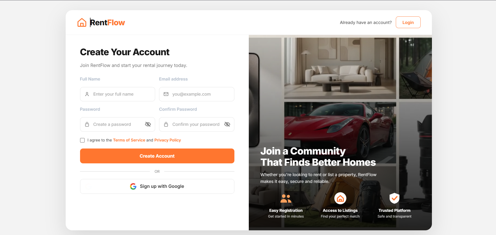

🔑 Login with Password

  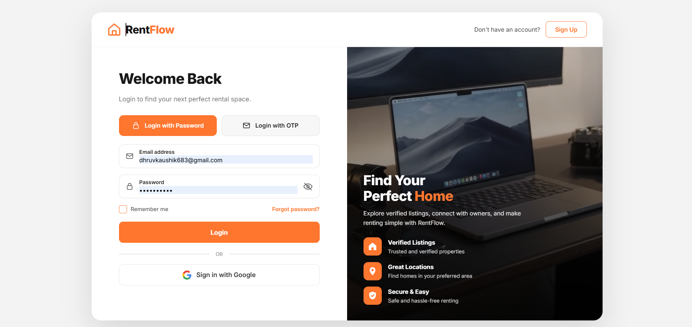

✉️ Login with Email OTP

  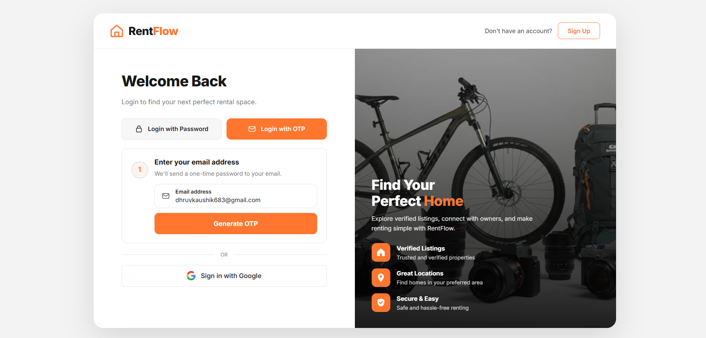

🏠 Homepage

  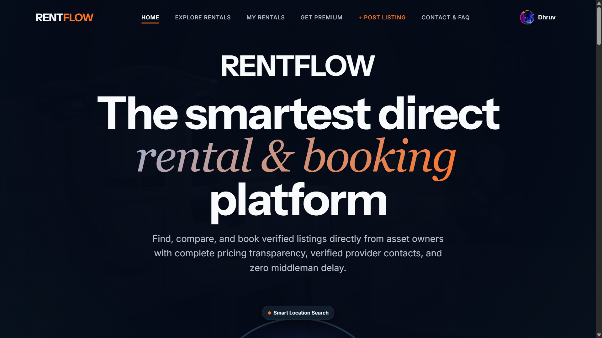

🔎 Explore Rentals

  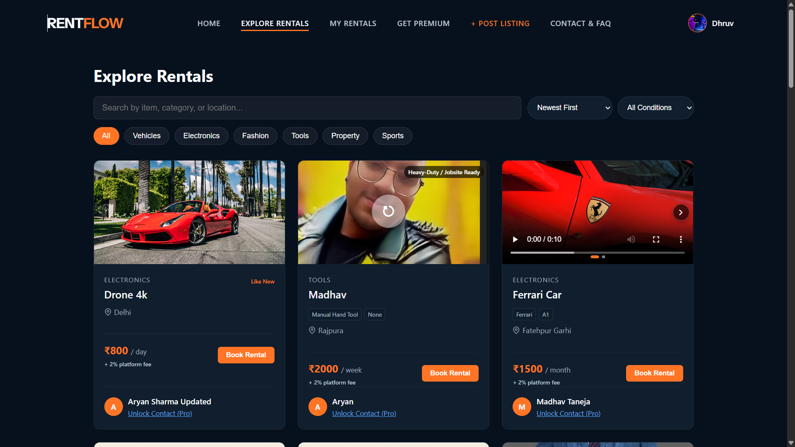

📋 My Rentals

  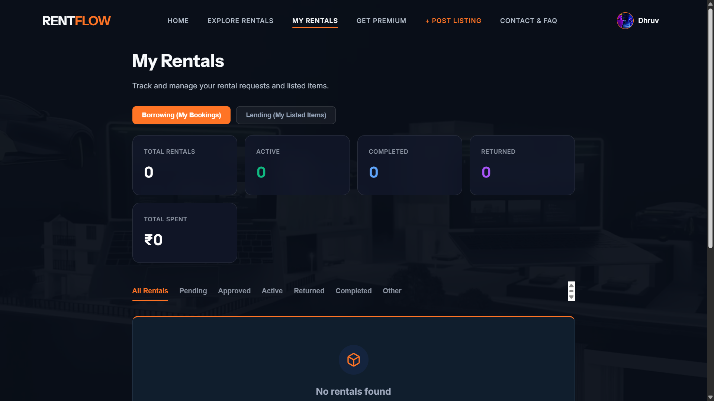

👑 RentFlow Premium

  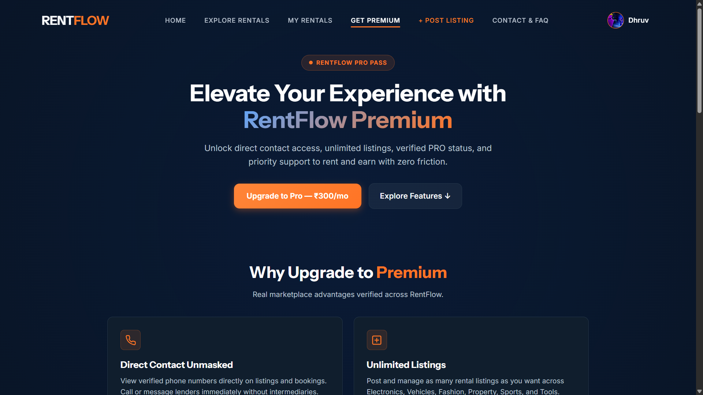

➕ Create a Listing

  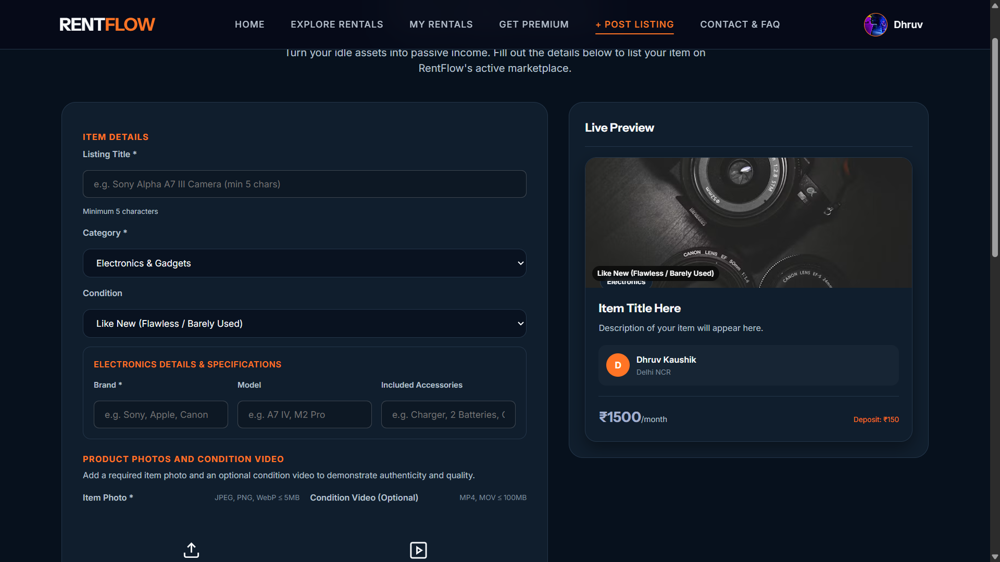

📞 Contact & FAQ

  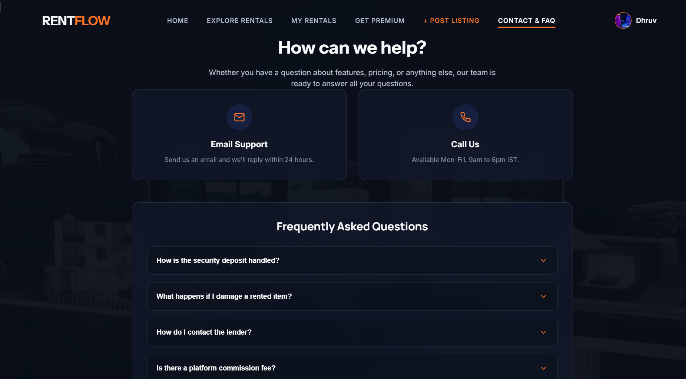

👤 User Profile

  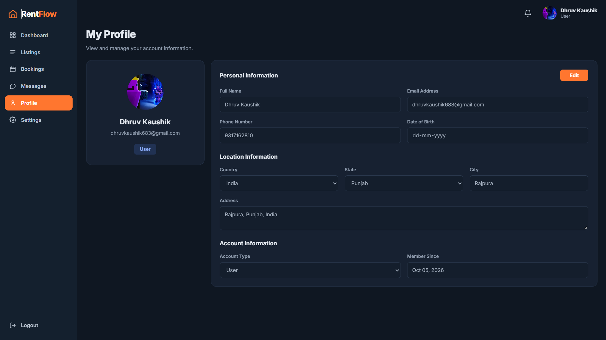

⚙️ Account Settings

  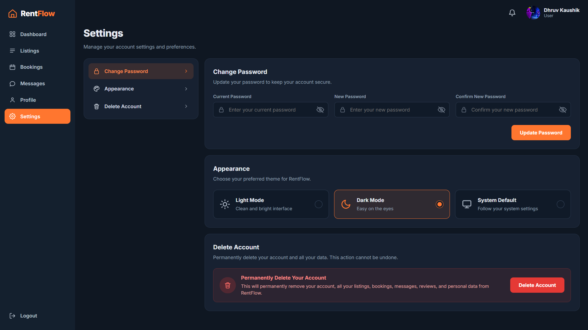

🛡️ Admin Dashboard

  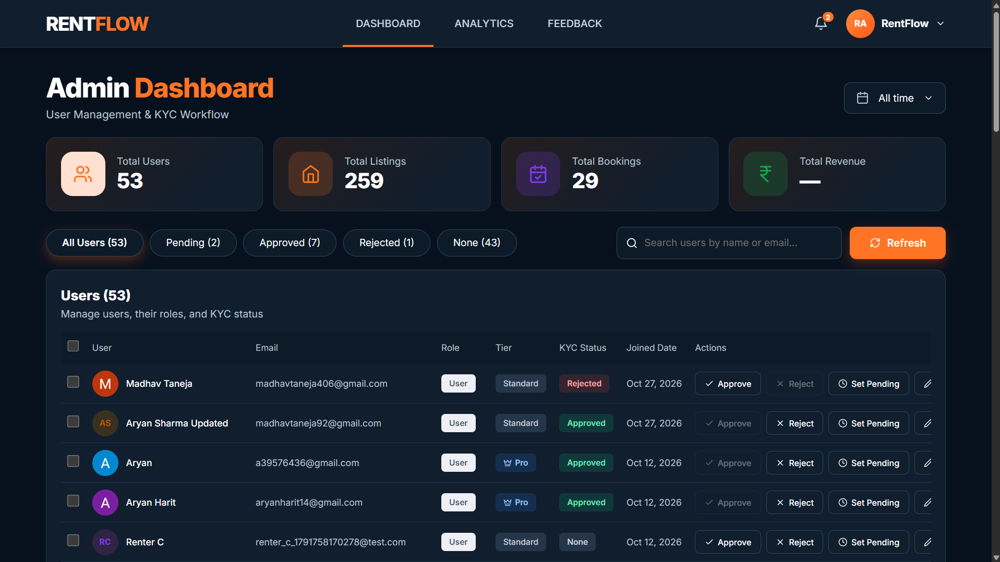

📊 Admin Analytics

  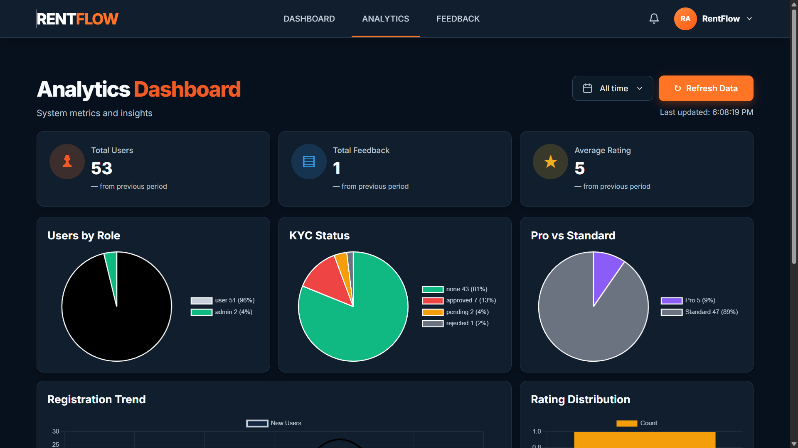

💬 Admin Feedback Management

  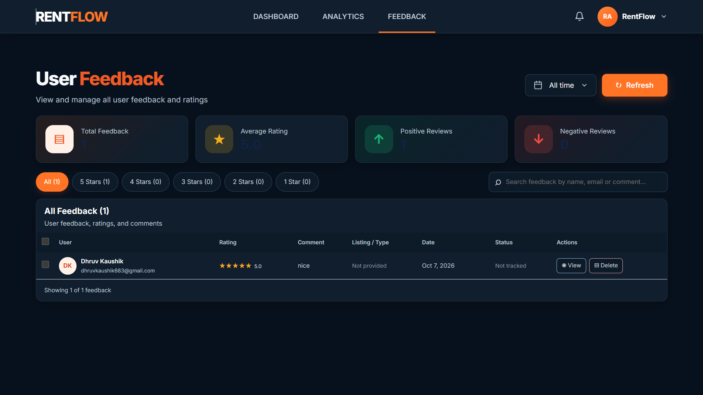

🚀 Getting Started
Prerequisites
- Node.js 18 or newer
- A MongoDB database (a free MongoDB Atlas cluster works)
- Optional, for specific features: Razorpay test keys, Google OAuth client ID, Cloudinary account, SMTP credentials
1. Clone the repository

git clone https\://github.com/mayank34000/RentFlow.git

cd RentFlow

2. Start the backend

cd backend

npm install

cp .env.example .env      # fill in your values

npm run dev               # nodemon (use "npm start" for plain node)

The API runs on http\://localhost:5000. Verify with:

curl http\://localhost:5000/api/health

3. Start the frontend

cd frontend/react

npm install

cp .env.example .env      # set VITE_API_URL and VITE_GOOGLE_CLIENT_ID

npm run dev

The app runs on http\://localhost:5173.

Other scripts: npm run build, npm run preview, npm run lint.
🔧 Environment Variables
Backend (backend/.env)
| Variable | Required | Description |

|---|---|---|

| MONGO_URI | Yes | MongoDB connection string |

| JWT_SECRET | Yes | JWT signing secret (server exits without it) |

| PORT | No | API port (default 5000) |

| NODE_ENV | No | development or production |

| CORS_ORIGIN | Production | Comma-separated allowed origins |

| RAZORPAY_KEY_ID, RAZORPAY_KEY_SECRET | Payments | Razorpay credentials |

| VITE_GOOGLE_CLIENT_ID | Google login | Google OAuth client ID (the backend reads this name) |

| CLOUDINARY_CLOUD_NAME, CLOUDINARY_API_KEY, CLOUDINARY_API_SECRET | Profile images | Cloudinary credentials |

| SMTP_HOST, SMTP_PORT, SMTP_USER, SMTP_PASS, MAIL_FROM | Emails | SMTP settings for OTP and receipts |

| RATE_LIMIT_WINDOW_MS, RATE_LIMIT_LOGIN_MAX, RATE_LIMIT_OTP_MAX, RATE_LIMIT_PAYMENT_MAX | No | Rate-limit overrides (defaults: 15 min, 5, 5, 10) |
Frontend (frontend/react/.env)
| Variable | Description |

|---|---|

| VITE_API_URL | Backend base URL, e.g. http\://localhost:5000 |

| VITE_GOOGLE_CLIENT_ID | Google OAuth client ID |
Never commit .env files. They are already git-ignored.

👥 Creating an Admin Account
There are no built-in demo accounts. Sign up normally, or create an admin with the helper script:
1. Open backend/createAdmin.js.
2. Set your own admin email and a strong password.
3. Run:

cd backend

node createAdmin.js

Security note: Never commit real admin credentials to the repository.

💾 Data Model
Data lives in MongoDB (Mongoose models in backend/models/):

| Model | Stores |

|---|---|

| User | Name, email, password hash, role, premium status, profile details |

| Listing | Title, category, condition, price/period, image, city, amenities, owner, status, views |

| Booking | Listing, renter, lender, dates, pricing, deposit, status, payment IDs, return photo/note |

| Conversation / Message | Booking-linked two-party chat and its messages |

| Notification | Per-user notifications with read state |

| Feedback | User rating and comment |

| ContactMessage | Contact form submissions |

| Otp | Hashed OTPs with expiry and attempt count |
🔄 Booking Lifecycle

Pending ──approve──▶ Approved ──pay (Razorpay verified)──▶ Active ──end date──▶ Completed ──owner confirms──▶ Returned

   │                    │

   ├── reject ─▶ Rejected

   └── cancel ─▶ Cancelled   (renter or admin, from Pending or Approved)

Terminal states: Rejected, Returned, Cancelled.
📡 API Reference
All routes are prefixed with /api. 🔒 = requires Authorization: Bearer \<token>, 👑 = admin only.
Auth: /api/auth
| Method | Path | Description |

|---|---|---|

| POST | /signup, /login, /google | Register, log in, Google sign-in |

| POST | /send-otp, /verify-otp | OTP verification |

| GET / PUT | /me 🔒 | Get or update current user |

| POST | /me/profile-image 🔒 | Upload profile image |

| POST | /forgot-password/send-otp | Start password reset |

| POST | /forgot-password/verify-otp | Verify reset OTP |

| POST | /forgot-password/reset | Set new password |
Listings: /api/listings
| Method | Path | Description |

|---|---|---|

| GET | / | List (search, category, city, minPrice, maxPrice) |

| GET | /my 🔒 | My listings |

| GET | /:id | Listing details |

| POST | / 🔒 | Create (multipart, field image) |

| PUT / DELETE | /:id 🔒 | Update or delete |
Bookings: /api/bookings
| Method | Path | Description |

|---|---|---|

| GET | /availability | Check availability |

| POST | / 🔒 | Create booking |

| GET | /my, /lender 🔒 | Bookings as renter / as owner |

| GET / DELETE | /:id 🔒 | View or cancel |

| PATCH | /:id/approve 🔒 | Owner approves |

| PATCH | /:id/pay 🔒 | Mark as paid |

| PATCH | /:id/return 🔒 | Confirm return (multipart, field returnPhoto) |
Payment: /api/payment 🔒
| Method | Path | Description |

|---|---|---|

| POST | /create-order | Create Razorpay order |

| POST | /verify | Verify payment signature |
Chat: /api/chat 🔒
| Method | Path | Description |

|---|---|---|

| GET / POST | /conversations | List, or get/create for a booking |

| GET / POST | /conversations/:id/messages | Fetch or send messages |

| PUT | /conversations/:id/read | Mark read |

| PUT | /conversations/:id/archive | Toggle archive |

| POST | /conversations/:id/report | Report conversation |

Socket.IO events: join_conversation, send_message, mark_read.
Notifications, Feedback, Contact
| Method | Path | Description |

|---|---|---|

| GET | /api/notifications 🔒 | My notifications |

| PUT | /api/notifications/read-all, /:id/read 🔒 | Mark read |

| POST | /api/feedback 🔒 | Submit feedback |

| GET | /api/feedback 👑 | All feedback |

| GET / PATCH / DELETE | /api/feedback/:id 🔒 | Manage one entry |

| POST | /api/contact | Contact message |

| GET | /api/health | Server and DB status |
Admin: /api/admin 👑
| Method | Path | Description |

|---|---|---|

| GET, PATCH, DELETE | /users, /users/:id | Manage users |

| GET, DELETE | /listings, /listings/:id | View or remove listings |

| PATCH | /listings/:id/status | Change listing status |

| GET | /bookings, /bookings/:id | View bookings |

| PATCH | /bookings/:id/cancel | Cancel booking |

| GET | /analytics/overview | Platform analytics |

A Postman collection and environment are included in the repo root.
📄 Main Pages
| Route | Purpose |

|---|---|

| / | Homepage and browse rentals |

| /login, /signup | Authentication |

| /profile, /settings, /messages, /reviews | Account area |

| /create-listing, /edit-listing/:id | Listing management |

| /booking, /booking-history | Booking flow and history |

| /chat | Messaging |

| /premium | Premium membership |

| /feedback, /give-feedback | Feedback |

| /contact, /about, /policy, /upcoming-features | Information pages |

| /admin-dashboard, /analytics | Admin tools |
🧪 Testing Checklist
- [ ] /api/health reports database connected
- [ ] Signup and login work
- [ ] Google login works
- [ ] OTP and forgot-password flow work
- [ ] Owner can create, edit and delete a listing
- [ ] Search, filter and price range work
- [ ] Booking price and availability are correct
- [ ] Owner can approve or reject a booking
- [ ] Feedback and contact forms submit
- [ ] Admin dashboard and analytics load
- [ ] Non-admin users are blocked from /api/admin
- [ ] Mobile navigation and theme switching work
🔒 Security
- Passwords are hashed with bcrypt; sessions use signed JWTs
- Admin routes are protected server-side
- Login, OTP and payment endpoints are rate limited
- Payment signatures are verified server-side (HMAC-SHA256)
- Uploads are restricted by type and size
- CORS is limited to CORS_ORIGIN
- Keep secrets in .env, and rotate any credential that has been committed or shared

RentFlow — Rent Anything. Easily & Securely.